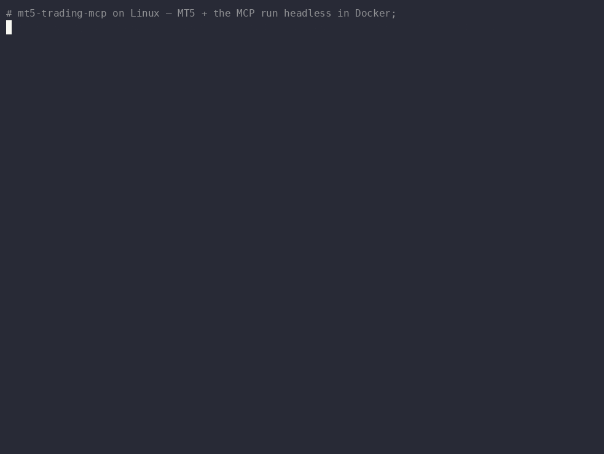
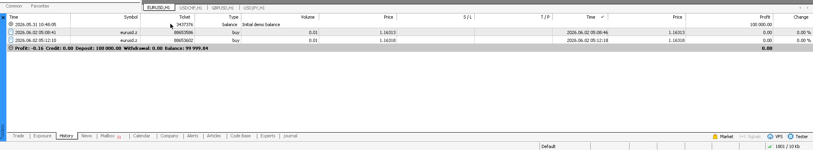

# MetaTrader 5 MCP Bridge

<!-- mcp-name: io.github.vincentwongso/mt5-trading-mcp -->

**Let an AI agent manage your MetaTrader 5 account over [Model Context Protocol](https://modelcontextprotocol.io) - with configurable human approval gate.**

[](https://pypi.org/project/mt5-trading-mcp/)
[](https://pepy.tech/project/mt5-trading-mcp)
[](https://pypi.org/project/mt5-trading-mcp/)
[](https://github.com/vincentwongso/mt5-trading-mcp/blob/main/LICENSE)
[](https://github.com/vincentwongso/mt5-trading-mcp/actions/workflows/test.yml)
[](https://github.com/vincentwongso/mt5-trading-mcp/stargazers)
[](https://modelcontextprotocol.io)
[](https://github.com/astral-sh/ruff)

<p align="center">
  <br>
  <sub>A <a href="https://github.com/NousResearch">Hermes</a> agent placing then closing a real 0.01-lot trade on a <b>demo</b> account, end-to-end over MCP on Linux.</sub>
</p>

<p align="center">
  <br>
  <sub>Not a mock-up - the same round-trip in MetaTrader 5's own History tab; the tickets and balance match the recording.</sub>
</p>

> ⚠️ **This software places _real_ trades through your MetaTrader 5 terminal with
> real orders and irreversible fills.** Read
> [DISCLAIMER.md](https://github.com/vincentwongso/mt5-trading-mcp/blob/main/DISCLAIMER.md)
> and [SECURITY.md](https://github.com/vincentwongso/mt5-trading-mcp/blob/main/SECURITY.md)
> before connecting it to a live account. Always test using your demo account first.

Runs locally - in the same process tree as your agent, no cloud, no telemetry.
Windows (native) or Linux (via Docker); Python 3.10+.

> 📖 **The story behind this:** this project is built step by step in
> [*Wiring AI agent into MetaTrader 5*](https://engineering.fintrixmarkets.com/posts/mt5-mcp-part-1/),
> Part 1 of the *Trade with AI agent* series on the Fintrix engineering blog.

## What it is

`mt5-mcp` lets an AI agent read your MetaTrader 5 account and place trades
through it, over the Model Context Protocol.

- **12 read-only tools**: account, quotes, positions, orders, history, OHLC
  bars, broker-authoritative margin estimates, and native chart screenshots
  (Windows). No consent gate.
- **4 mutating tools**: `place_order`, `modify_order`, `cancel_order`,
  `close_position`, each behind a preflight + human-consent + idempotency +
  audit layer.
- **3 subscribable resources**: live `account://`, `positions://`, and
  `quotes://{symbol}` snapshots that push change notifications.
- **3 ready-to-use Claude Code skills** ship in
  [`.claude/skills/`](https://github.com/vincentwongso/mt5-trading-mcp/tree/main/.claude/skills):
  `mt5-market-data` and `mt5-trading` teach an agent how to read the account and
  run the consent flow safely; `mt5-mql5-build` teaches the MQL5 compile loop.

Full catalogue and the consent flow: **[docs/tools.md](https://github.com/vincentwongso/mt5-trading-mcp/blob/main/docs/tools.md)**.

## Why mt5-mcp

- **A safety layer, not just an API wrapper.** Every mutating call routes through
  preflight checks -> an opt-in human-consent gate (arm it to require approval) ->
  idempotency -> an append-only audit log, so you can put a human in the loop on
  trades and always keep a replayable record of what the agent did.
- **An honest threat model.** It treats an LLM wired to `place_order` as a live
  attack surface and says so plainly - the MCP is explicitly *not* the security
  boundary (see [SECURITY.md](https://github.com/vincentwongso/mt5-trading-mcp/blob/main/SECURITY.md)).
- **Verifiable proof, not a mock-up.** The demo above is a real round-trip; the
  tickets and balance match MetaTrader 5's own History tab.
- **Local-first.** No cloud, no telemetry; runs beside your agent. Windows-native
  or Linux via an all-in-one Docker image (no `rpyc` version-matching).

## Quickstart (Windows, native)

```bash
pip install mt5-trading-mcp
```

1. Launch MetaTrader 5 and log into your broker. Enable **AlgoTrading** (toolbar
   button green).
2. Verify the terminal is reachable: `python -m mt5_mcp doctor`: expect
   `[INFO] backend: native` and `[PASS]` lines.
3. Run it: `python -m mt5_mcp serve`.

Wire it to OpenClaw in one command (registers the `mcp.servers` entry):

```bash
openclaw mcp set mt5-mcp '{"command":"python","args":["-m","mt5_mcp","serve"]}'
```

## Quickstart (Linux, Docker)

The MT5 terminal + the MCP run headless in an all-in-one image; your agent talks
MCP over HTTP. No host Python, no bridge.

```bash
cp deploy/.env.example deploy/.env   # add MT5_LOGIN / MT5_PASSWORD / MT5_SERVER
docker compose -f deploy/docker-compose.yml up -d
```

Log the terminal in once via the KasmVNC web UI at `http://127.0.0.1:3001`
(**File -> Login to Trade Account**; persists across restarts), then point your
agent at `http://127.0.0.1:8765/mcp`. Wire it to OpenClaw in one command:

```bash
openclaw mcp set mt5-mcp '{"url":"http://127.0.0.1:8765/mcp","transport":"streamable-http"}'
```

The image runs Wine 11.10 staging, which runs current MT5 builds (Wine 10 could
not run builds newer than 28 Sep 2026). The terminal is no longer pinned, so
MT5's LiveUpdate keeps it current. To build and backtest EAs on Linux, use the
backtest container in `deploy/docker-compose.backtest.yml` (see
[docs/agents.md](docs/agents.md)).

Known issue: fresh volumes. A new terminal does not know your broker's server,
and its Login dialog can draw as a black box under Wine, so it never logs in
(the MCP server then reports IPC timeouts). Workaround, once per volume:
1. Copy `servers.dat` (server addresses only) from a terminal that knows the
   broker, e.g. a Windows install's `%APPDATA%\MetaQuotes\Terminal\<id>\config\`,
   into `/config/.wine/drive_c/Program Files/MetaTrader 5/Config/` (owner `abc`).
2. Log in with a one-off start config: stop the terminal and run
   `terminal64.exe "/config:C:\autologin.ini"` as `abc`, where the ini has
   `[Common]` `Login=`, `Password=`, `Server=` and `KeepPrivate=1`. Delete the
   ini once the journal says `authorized`.
3. So the login survives restarts, add `Login=` and `Server=` (no password)
   under `[Common]` in `Config/common.ini` (UTF-16) while the terminal is
   stopped.

Full walkthrough:
**[docs/installation.md](https://github.com/vincentwongso/mt5-trading-mcp/blob/main/docs/installation.md)**.

## Chart screenshots

`get_chart_screenshot(symbol, timeframe, annotations?)` returns a PNG of the
native MT5 chart, optionally annotated, so an LLM can read it visually
(candles, support/resistance, patterns). Because the MetaTrader5 Python API
cannot capture charts, this uses a small MQL5 Expert Advisor that runs inside
a GUI terminal and calls `ChartScreenShot()`.

See [Chart annotations](docs/tools.md#chart-annotations) for marking up
support/resistance lines, trendlines and notes before capture.

Setup (one time):

1. Install and attach the `AgentScreenshot` EA - see `mql5/README.md`.
2. Optionally set a template so your indicators/drawings appear in the shot:
   `[screenshot]` `template = "agent.tpl"` in your config, or leave it unset
   for the default chart.

Config knobs (`[screenshot]` section): `width` (default 1600), `height`
(default 900), `template` (default none), `timeout_s` (default 10).

Docker: the image preinstalls the EA, the light template and a startup ini on
every boot, so no manual setup is needed. Set `MT5_EA_SYMBOL` (default
`BTCUSD`) to a symbol your account has, otherwise screenshots time out. The
light template is wired in only when the first boot seeds `config.toml`; on a
volume that already has one, add `[screenshot]` `template = "agent_light.tpl"`
by hand (an existing `config.toml` also ignores `MT5_MCP_AUTH_TOKEN`).
Elsewhere (macOS, native Linux) the tool returns `SCREENSHOT_NOT_SUPPORTED`.

## Build MQL5 with an agent

`mt5-mcp compile <file.mq5>` compiles an Expert Advisor, indicator or script
with your local MetaEditor (Windows) and prints one line per problem
(`src/MyEA.mq5:42:7: error 256: ...`). An agent with a shell runs it, fixes
the errors and reruns until it exits 0. Clean builds install to
`MQL5\<Kind>\Agent\` in the terminal's data folder; you attach them
yourself. Reinstalling an EA that is attached to a live chart reloads the new
code on that chart. Agents get the loop from the `mt5-mql5-build` skill.
Exit codes: `0` built, `1` compile errors, `2` could not run. On Linux both
commands run in the backtest container (`deploy/docker-compose.backtest.yml`)
via `docker exec mt5-backtest mt5-mcp ...`.

`mt5-mcp backtest <ea.ex5>` then runs the Strategy Tester on that build
(single run, or `--optimize full|genetic` with a forward test on by default)
and prints a short summary or a ranked table of input sets. It runs on a
separate copy of MT5 made once with `mt5-mcp backtest --setup`, so your live
terminal is never touched. Windows (from a logged-in desktop session) or the
Linux backtest container.

## For AI agents

**If you've been handed this repository to install and run, follow the runbook
in [docs/agents.md](https://github.com/vincentwongso/mt5-trading-mcp/blob/main/docs/agents.md).**
It covers platform detection, install, verification, registering the server, and
the hard safety rules for trades - read it before calling any mutating tool.

## Documentation

| Guide | What's in it |
|---|---|
| [Installation & setup](https://github.com/vincentwongso/mt5-trading-mcp/blob/main/docs/installation.md) | Requirements, Windows + Linux/Docker setup, wiring to an agent. |
| [For AI agents](https://github.com/vincentwongso/mt5-trading-mcp/blob/main/docs/agents.md) | Step-by-step runbook for an agent installing and running the server. |
| [Configuration](https://github.com/vincentwongso/mt5-trading-mcp/blob/main/docs/configuration.md) | `config.toml` schema, storage paths, hot-reload. |
| [Tools & resources](https://github.com/vincentwongso/mt5-trading-mcp/blob/main/docs/tools.md) | Read tools, mutating tools + consent flow, subscribable resources. |
| [MCP client setup](https://github.com/vincentwongso/mt5-trading-mcp/blob/main/docs/clients.md) | Per-client config snippets and Claude Code usage. |
| [Transports & deployment](https://github.com/vincentwongso/mt5-trading-mcp/blob/main/docs/deployment.md) | stdio/HTTP transports and Windows VPS patterns. |
| [Contributing](https://github.com/vincentwongso/mt5-trading-mcp/blob/main/CONTRIBUTING.md) | How to contribute and run the tests. |
| [Changelog](https://github.com/vincentwongso/mt5-trading-mcp/blob/main/CHANGELOG.md) | Release history and known limitations. |

## Safety

`mt5-mcp` is **not** the security boundary, the broker's MT5 server enforces
the hard limits (margin, max-lot, symbol permissions). Pre-flight checks in the
policy engine are UX guardrails to catch agent mistakes early, not security
controls.

The human-consent gate is **opt-in and off by default**: `auto_approve_notional`
defaults to `0`, so mutating calls auto-execute (full-open) - intended for trusted
or unattended agents. **Arm the gate by setting `auto_approve_notional` > 0**:
orders/closes whose notional is at or above it then return an `ApprovalPreview`
you must confirm, and modifying a stop to widen or remove it also requires
approval. The pre-flight limits (`max_*`) and symbol allow/deny lists are likewise
opt-in (`0` / empty = off). Every mutating call is recorded in an append-only audit
JSONL log regardless. For vulnerability disclosure, see
[SECURITY.md](https://github.com/vincentwongso/mt5-trading-mcp/blob/main/SECURITY.md).

## Architecture

`mt5-mcp` wraps the MetaTrader 5 Python library behind a FastMCP server. A single `MT5Client` (`src/mt5_mcp/adapter/`) owns the terminal connection, broker-timezone inference, and type conversions; everything else sits on top of it. The Pydantic models in `src/mt5_mcp/types.py` / `src/mt5_mcp/config.py` are the source of truth for the data and config schemas.

```
     Agent / MCP client  (Hermes, OpenClaw, Claude Code, Claude Desktop, …)
                               │
                               │   stdio  ·  loopback HTTP
                               ▼
 ┌──────────────────────────────────────────────────────────┐
 │                      FastMCP server                      │
 │                                                          │
 │   tools/        resources/        policy/                │
 │   read +        subscribable      consent · idempotency  │
 │   mutating      account/quotes    · audit (JSONL)        │
 │                                                          │
 │   streaming/  - change-detection poller + dispatcher     │
 │   types.py · config.py - Pydantic schemas: source of     │
 │                          truth for data + config         │
 │                                                          │
 └──────────────────────────────────────────────────────────┘
                               │
                               ▼
 ┌──────────────────────────────────────────────────────────┐
 │                                                          │
 │   adapter/  MT5Client                                    │
 │   one terminal connection · broker-TZ inference ·        │
 │   type conversions · transparent reinit                  │
 │                                                          │
 └──────────────────────────────────────────────────────────┘
                               │
                               ▼
MetaTrader 5 Python library  ->  broker terminal  ->  broker server
```

The module paths shown (`tools/`, `resources/`, `policy/`, `streaming/`,
`adapter/`, `types.py`, `config.py`) all live under `src/mt5_mcp/`.

## Contributing

Contributions are welcome, see
[CONTRIBUTING.md](https://github.com/vincentwongso/mt5-trading-mcp/blob/main/CONTRIBUTING.md)
for the dev setup, test workflow, and project principles.

## License

MIT - see [`LICENSE`](https://github.com/vincentwongso/mt5-trading-mcp/blob/main/LICENSE).
